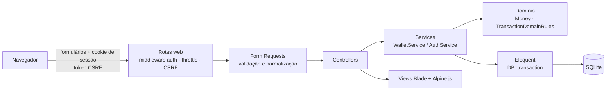
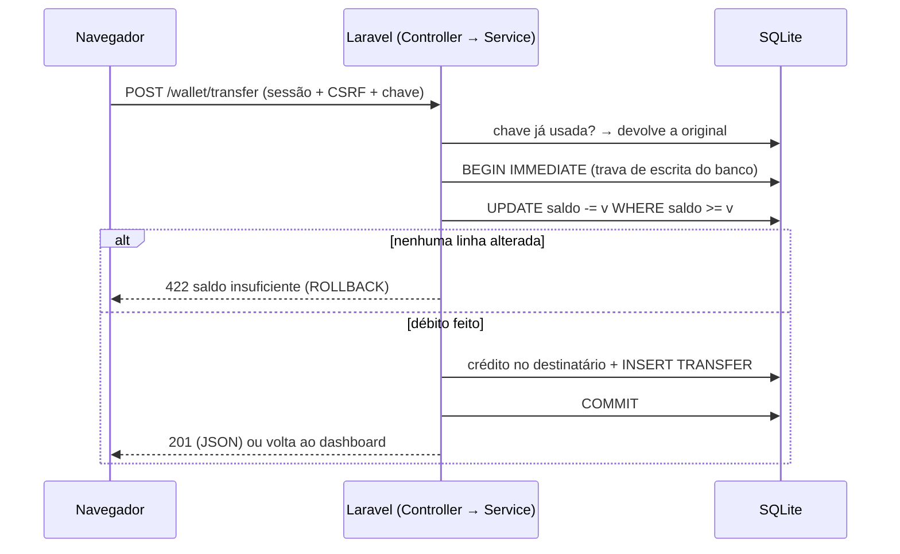
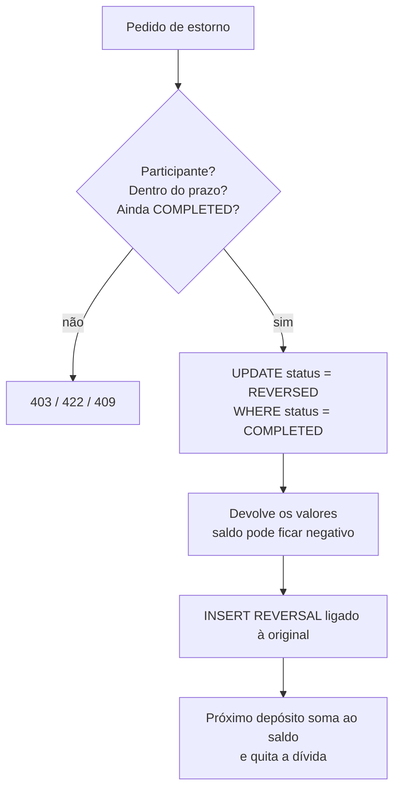
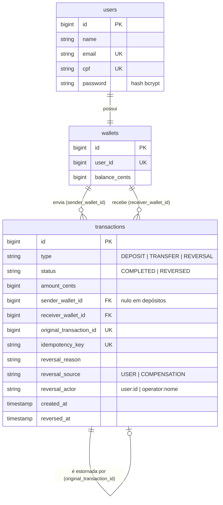

# Cobuccio Wallet — PHP · Laravel

Carteira financeira digital feita para o desafio técnico full stack do **Grupo Adriano Cobuccio**: cadastro, autenticação, depósitos, transferências entre usuários, extrato e estorno de operações.

O mesmo produto também foi implementado em **Node.js (NestJS + Next.js)** (repositório `desafio-dev-next`). As regras de negócio, os limites e as contas de demonstração são os mesmos; a arquitetura de cada um segue o próprio framework. A comparação completa está em [`docs/COMPARACAO_TECNICA.md`](docs/COMPARACAO_TECNICA.md).

**Diferenciais implementados:** valores em centavos inteiros, ledger imutável com estorno por contra-lançamento, idempotência de depósitos e transferências, proteção contra gasto duplo testada com processos PHP simultâneos, compensação interna auditável, limite de requisições e PHPStan nível 8.

---

## 1. Visão geral

| Funcionalidade | O que faz |
| :--- | :--- |
| Cadastro | Cria o usuário e a carteira (saldo zero) numa única transação |
| Autenticação | Login com e-mail e senha; sessão do Laravel com proteção CSRF |
| Dashboard | Saldo, totais, atalhos e últimas movimentações |
| Depósito | Credita a carteira; se o saldo estiver negativo, quita a dívida primeiro |
| Transferência | Envia dinheiro a outro usuário por e-mail ou CPF |
| Extrato | Histórico com filtros, situação de cada operação e prazos de estorno |
| Estorno | Reverte depósitos e transferências criando um lançamento `REVERSAL` |

---

## 2. Regras de negócio

> Estas regras são idênticas no projeto Node.

**Cadastro**
- Nome: 3 a 100 caracteres. E-mail: normalizado (sem espaços, minúsculo). CPF: exatamente 11 dígitos, gravado sem máscara (não há validação de dígito verificador em nenhuma das versões).
- Senha: 8 a 72 caracteres (72 é o limite que o bcrypt considera), gravada com hash bcrypt.
- E-mail e CPF únicos: duplicidade retorna **409**.

**Valores**
- Sempre em centavos inteiros (`R$ 10,50` → `1050`); nunca ponto flutuante.
- Por operação: mínimo R$ 0,01 e máximo **R$ 1.000.000,00**. O teto é uma decisão conservadora desta implementação, não um requisito do desafio, e fica centralizado em `Money::MAX_OPERATION_CENTS`.

**Depósito:** soma o valor ao saldo. Com saldo de −R$ 50,00, um depósito de R$ 100,00 deixa R$ 50,00 disponíveis.

**Transferência:** destinatário por e-mail ou CPF; não pode ser a própria carteira; exige saldo suficiente. Débito, crédito e registro acontecem numa única transação. Uma transferência nunca deixa o saldo negativo.

**Estorno**
- A operação original passa a `REVERSED` e é criado um lançamento `REVERSAL` ligado a ela (`original_transaction_id`, único). Nada é apagado.
- Um estorno não pode ser estornado, e a mesma operação não pode ser estornada duas vezes (**409**).
- O estorno pode deixar o saldo negativo, se quem recebeu já gastou o valor; o próximo depósito regulariza.

| Operação | Quem pode estornar | Prazo |
| :--- | :--- | :--- |
| Transferência | Remetente | 15 minutos |
| Transferência | Destinatário (devolução) | 24 horas |
| Depósito | Titular | 24 horas |

Os prazos são uma política desta aplicação, não do enunciado.

**Compensação por inconsistência técnica:** um estorno interno, sem as janelas de prazo do usuário, para corrigir erros técnicos (ex.: crédito duplicado encontrado numa conciliação). Não existe rota HTTP para isso: só o comando Artisan `wallet:compensate` (executado no servidor) chama a operação. Exige justificativa (mín. 10 caracteres) e responsável, grava `reversal_source = COMPENSATION` e `reversal_actor = operator:<nome>` no lançamento `REVERSAL`, e não compensa duas vezes a mesma operação.

```bash
php artisan wallet:compensate <id> --reason="Crédito duplicado na conciliação" --operator=<responsável>
# no container: docker compose exec app php artisan wallet:compensate ...
```

**Idempotência:** depósitos e transferências aceitam uma chave (`X-Idempotency-Key` ou campo `idempotency_key`). Repetir a chave devolve a operação original sem mover dinheiro; reutilizá-la em outra operação — ou usar a chave de outro usuário — retorna **409**, sem expor a operação original.

**Limite de requisições:** login e cadastro, 10/min (por e-mail + IP); operações da carteira, 30/min (por usuário). Acima disso, **429** para clientes JSON; nos formulários, a página volta com a mensagem de erro.

**Códigos HTTP (respostas JSON):** 201 criação · 200 consulta e estorno · 401 não autenticado/credencial inválida · 403 sem permissão · 404 inexistente · 409 conflito · 422 dado inválido ou regra violada · 429 limite.

---

## 3. Stack

| Camada | Tecnologia |
| :--- | :--- |
| Aplicação | PHP 8.4, Laravel 13 |
| Interface | Blade, Alpine.js, Tailwind CSS 4 (Vite) |
| Dados | Eloquent + SQLite |
| Qualidade | PHPUnit, PHPStan nível 8 (Larastan), Laravel Pint |
| Infra | Docker Compose (PHP-FPM + Nginx) |

---

## 4. Arquitetura

Monólito modular: o mesmo servidor renderiza as páginas e processa os formulários. As rotas respondem HTML ou JSON conforme o header `Accept`.



| Pasta | Responsabilidade |
| :--- | :--- |
| `app/Http/Requests` | Validação e normalização (valor em `R$` → centavos, CPF sem máscara) |
| `app/Http/Controllers` | Finos: chamam o serviço e escolhem HTML ou JSON |
| `app/Services` | Transações, idempotência e escrita no ledger |
| `app/Domain/Wallet` | Regras puras, sem Eloquent: `Money`, `TransactionDomainRules` |
| `resources/views` | Blade + Alpine.js |

---

## 5. Fluxos principais

**Transferência**



**Estorno e recuperação de saldo negativo**



**Cadastro e login:** o cadastro valida o Form Request (duplicidade → 409), grava usuário + carteira em `DB::transaction` e abre a sessão. O login usa `Auth::attempt()` e regenera o ID da sessão.

---

## 6. Modelo de dados



Índices compostos `(sender_wallet_id, created_at)` e `(receiver_wallet_id, created_at)` para o extrato. As tabelas `sessions`, `cache`, `jobs` e `password_reset_tokens` são as padrão do Laravel.

---

## 7. Autenticação e segurança

- **Sessão do Laravel:** `Auth::attempt()`, middleware `auth`, ID de sessão regenerado no login (contra *session fixation*) e invalidado no logout. Senhas com bcrypt.
- **Cookies:** sessão criptografada (`SESSION_ENCRYPT=true`), `HttpOnly` e `SameSite=Lax`. Em produção com HTTPS, defina `SESSION_SECURE_COOKIE=true`.
- **CSRF:** todo formulário de mutação envia `@csrf`, conferido pelo middleware do Laravel; um POST sem token recebe **419**. Isso é necessário justamente porque a autenticação é por cookie.
- **Dados pessoais:** a lista de contatos mostra o CPF mascarado (`***.666.777-**`).
- **Mass assignment:** os models declaram `$fillable`; saldos só mudam pelo `WalletService`.
- **Autorização:** só o titular vê a própria carteira; estornar exige ser participante da operação.

---

## 8. Persistência e consistência

- **SQLite + migrations do Laravel.** Toda operação financeira roda em `DB::transaction()`.
- **Sobre `lockForUpdate()`:** no SQLite ele não faz nada (não existe `SELECT ... FOR UPDATE`). A proteção real vem de duas coisas:
  1. `transaction_mode = IMMEDIATE` (em `config/database.php`): a transação já começa com a trava de escrita do banco, então operações concorrentes esperam (`busy_timeout` de 5 s) em vez de falhar no meio.
  2. Débito com `UPDATE` condicional (`balance_cents >= valor`) e saldos alterados com `increment`/`decrement` atômicos.

  O `lockForUpdate()` continua no código porque protege a mesma operação se o banco for trocado por MySQL ou PostgreSQL.
- **Comprovação:** `tests/Concurrency` sobe **dois processos PHP separados** que disputam o mesmo saldo num arquivo SQLite no mesmo instante: só uma transferência passa. O mesmo teste prova que duas requisições simultâneas com a mesma chave de idempotência creditam uma única vez.
- **Estorno duplicado:** a mudança para `REVERSED` só acontece `WHERE status = COMPLETED`; um segundo pedido recebe 409.
- **Rollback:** testado com uma falha simulada ao gravar o lançamento; nenhum saldo muda.

---

## 9. Como executar

**Pré-requisitos:** Docker, ou PHP 8.3+, Composer e Node.js (para os assets).

### Docker (recomendado)

```bash
docker compose up --build
```

Não precisa configurar nada: o container copia o `.env`, instala as dependências, gera a `APP_KEY` e roda migrations e seed. O banco SQLite fica no volume `sqlite_data` (persiste entre reinícios e não se mistura com o banco local).

Acesse http://localhost:8000 · healthcheck em `/api/health`.

### Local

```bash
cp .env.example .env
composer install
php artisan key:generate
touch database/database.sqlite
php artisan migrate --seed
npm install && npm run build
php artisan serve
```

Acesse http://localhost:8000.

---

## 10. Usuários de demonstração

Criados pelo seed (iguais aos do projeto Node). Senha de todos: `password123`.

| Titular | E-mail | Saldo inicial | Cenário |
| :--- | :--- | :--- | :--- |
| Gabriel Cobuccio | `gabriel@cobuccio.com` | R$ 1.450,00 | Histórico de depósito e transferência |
| Bruno Costa | `bruno@cobuccio.com` | R$ 800,00 | Destinatário de transferências |
| Mariana Souza | `mariana@cobuccio.com` | −R$ 250,00 | Saldo negativo após estorno |

---

## 11. Testes

```bash
php artisan test                 # 60 testes: Unit, Feature e Concurrency
php vendor/bin/phpstan analyse   # nível 8, sem erros
php vendor/bin/pint --test       # padrão de código
```

Resultado da última execução: **60 testes, todos passando**. As suítes Unit e Feature usam SQLite em memória; a suíte Concurrency usa um arquivo temporário, porque só assim dois processos compartilham o banco.

`tests/Feature/ParityScenariosTest.php` reproduz os mesmos cenários do `parity.e2e-spec.ts` do projeto Node.

---

## 12. Decisões técnicas

- **Sessão em vez de JWT:** num monólito Blade a sessão é o padrão do framework e permite encerrar o acesso na hora.
- **Domínio sem Eloquent:** as regras financeiras são testadas sem banco.
- **IMMEDIATE + `UPDATE` condicional:** a forma correta de serializar escritas no SQLite; o `lockForUpdate()` fica para bancos com lock por linha.
- **Chave de idempotência no formulário:** cada carregamento da página gera um UUID; um duplo envio do mesmo formulário reaproveita a chave.

---

## 13. Limitações conhecidas

- Não há gateway de pagamento, integração bancária nem webhooks: o dinheiro é apenas um saldo interno.
- SQLite serializa todas as escritas; para volume real, MySQL ou PostgreSQL.
- O limite de requisições usa o cache da aplicação (`CACHE_STORE=database`); com várias instâncias, o ideal seria Redis.
- A compensação técnica não tem tela: é executada por linha de comando por quem tem acesso ao servidor. Não há papéis administrativos na aplicação.
- A concorrência foi testada com dois processos na mesma máquina, não sob carga real com vários servidores.
